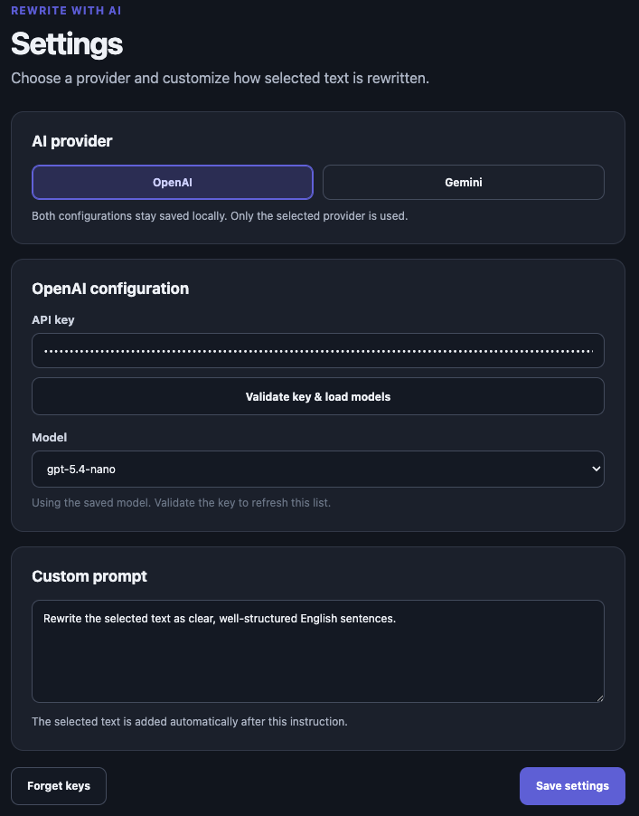
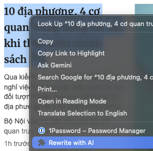
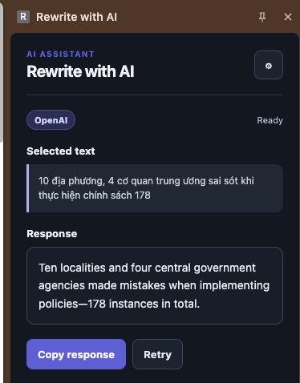

# Rewrite with AI

A personal-use Chrome extension that rewrites selected webpage text with OpenAI or Gemini and shows the answer in Chrome's side panel.

## Requirements

- Chrome 116 or newer.
- An [OpenAI API key](https://platform.openai.com/api-keys) or a [Gemini API key](https://aistudio.google.com/app/apikey).

Provider API usage may incur charges on the account associated with the configured key.

## Install locally

1. Open `chrome://extensions` in Chrome.
2. Enable **Developer mode**.
3. Click **Load unpacked**.
4. Choose the repository folder containing `manifest.json`.
5. Open the extension's **Details** page and select **Extension options**.

Chrome keeps the unpacked extension linked to this folder. After updating its files, use the refresh button on `chrome://extensions`.

## Configure

1. Choose **OpenAI** or **Gemini**.
2. Enter that provider's API key.
3. Keep the suggested model or enter another model available to your provider account.
4. Edit the rewrite instruction if desired. The default is:
  > Rewrite the selected text as clear, well-structured English sentences.

   

5. Click **Save settings**.

Both provider configurations remain in local Chrome extension storage, but only the selected provider is called. **Forget keys** removes both saved API keys while preserving the other settings.

## Use

1. Select text on a webpage.
2. Right-click the selection.

   

3. Choose **Rewrite with AI**
4. The Chrome side panel opens immediately and shows progress, the selected text, and the provider response.

   

5. Use **Copy response** to copy the result or **Retry** to repeat the last request with the current settings.

If the provider configuration is missing or rejected, choose **Open settings** from the error state, correct it, and retry.

## Privacy and API-key safety

- API keys are stored in `chrome.storage.local`, not synchronized storage.
- Storage access is restricted to trusted extension pages.
- The extension sends requests only to the official OpenAI and Gemini HTTPS API origins.
- The webpage and its scripts never receive an API key; no content script is used.
- Selected text and responses are kept only in `chrome.storage.session` and expire with the browser session.
- Output is rendered as text, never interpreted as webpage HTML.
- The extension has no analytics, telemetry, remote scripts, or runtime dependencies.

Local extension storage is not a hardware-backed secret vault. Malware or a person with access to the Chrome profile may still obtain locally stored keys. Use restricted provider keys where supported, monitor usage, and revoke a key if you suspect exposure.

## Develop and test

No dependency installation or build step is required.

```bash
node --test
```

Check JavaScript syntax:

```bash
find src tests -name '*.js' -print0 | xargs -0 -n1 node --check
```


## Manual verification checklist

- [ ] Chrome loads the unpacked extension without manifest or service-worker errors.
- [ ] The options page initially selects OpenAI and displays the default prompt and models.
- [ ] OpenAI settings save and remain after closing and reopening the options page.
- [ ] Gemini settings save and remain after closing and reopening the options page.
- [ ] Switching providers displays the matching key and model while preserving the other provider's values.
- [ ] **Forget keys** clears both keys and keeps the provider, models, and prompt.
- [ ] The context-menu item appears when non-empty webpage text is selected.
- [ ] The context-menu item does not appear when no text is selected.
- [ ] Selecting the menu item immediately opens the side panel in a loading state.
- [ ] A valid OpenAI configuration produces a response.
- [ ] A valid Gemini configuration produces a response.
- [ ] **Copy response** copies the complete plain-text result.
- [ ] **Retry** repeats the last selected text using the latest saved settings.
- [ ] Missing/invalid keys, invalid models, rate limits, and network failures show readable errors without secret values.
- [ ] Settings persist after restarting Chrome.
- [ ] Selected text and the response disappear after ending the browser session.